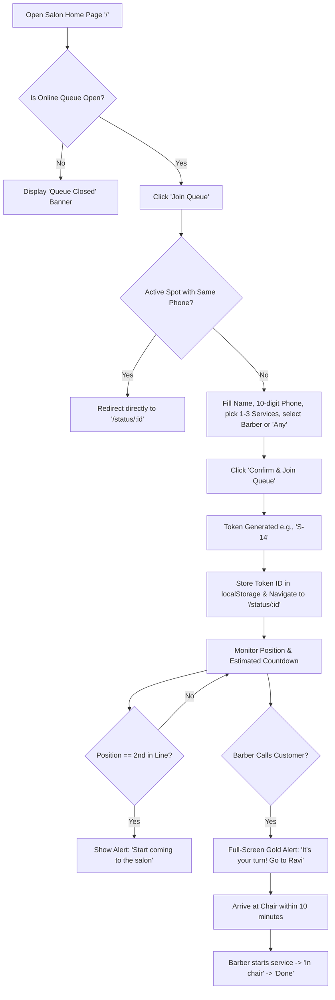
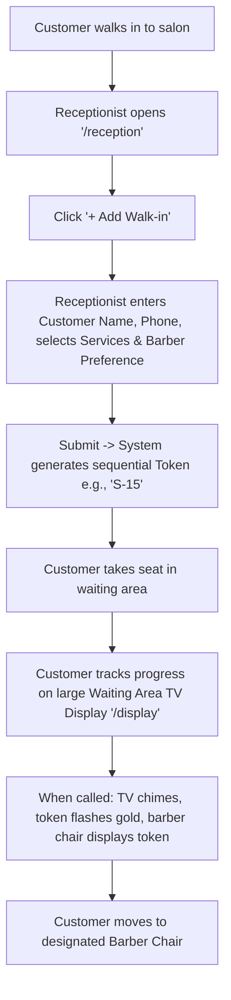
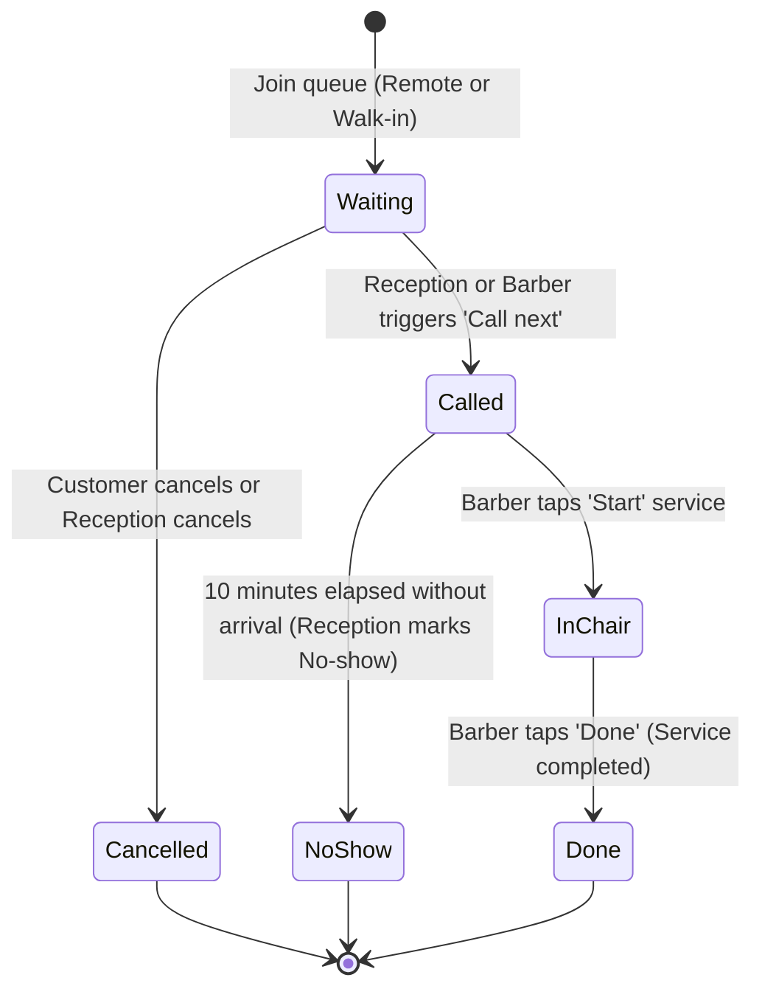

# 03 - Flows, Queue Business Rules & Test Checklist

---

## 1. User Flows

### A. Remote Customer Journey (Mobile Web)

### B. Walk-In Customer Journey (Reception Desk)

---

## 2. Queue Status State Machine & Allowed Transitions

Queue tokens strictly adhere to a one-way unidirectional state machine. **States can never transition backwards.**

### Strict Transition Rules:
| Current State | Next State | Permitted Initiator | Conditions & Constraints |
| :--- | :--- | :--- | :--- |
| `Waiting` | `Called` | Barber or Receptionist | Barber chair must be free; customer matched by barber algorithm. |
| `Waiting` | `Cancelled` | Customer or Receptionist | Customer self-cancels or requests removal. |
| `Called` | `In chair` | Barber | Customer is physically in the chair; barber taps `[Start]`. |
| `Called` | `No-show` | Receptionist | Customer fails to arrive within 10 min window. |
| `In chair` | `Done` | Barber | Service complete; barber taps `[Done]`. |

> [!IMPORTANT]
> - Never transition backward (e.g., `In chair` cannot revert to `Waiting` or `Called`).
> - Cancelled and No-show states are terminal. If a customer returns after being marked `No-show`, they must be re-added as a completely **new entry at the end of the queue** with a new token.

---

## 3. Core Business & Queue Management Rules

### 1. First-Come, First-Served (FCFS) with Preference Routing
Queue seniority is strictly chronological based on the creation timestamp (`created_at`).
When `Call next` is triggered for **Barber X**:
- The queue engine scans all customers with status `Waiting`, ordered by arrival time (`created_at ASC`).
- It selects the **earliest customer** whose preference matches:
  `preferred_barber == Barber X` **OR** `preferred_barber == 'any'`.
- **Strict Isolation**: A customer who explicitly chose `Ravi` will **never** be assigned to `Amit`, `Kunal`, or any other barber, even if other barbers become idle before Ravi is free.

### 2. Single-Occupancy Chair Invariant
- A barber can have **at most one customer** in the `In chair` status at any given time.
- A barber cannot call another customer if their chair currently holds an active customer in `In chair` or `Called` status without completing or closing the active one.

### 3. Estimated Waiting Time Calculation Formula
For any waiting customer $C$ at position $k$, the estimated wait time $W(C)$ in minutes is calculated as:

$$\text{Estimated Wait Time} \approx \frac{\sum \text{Service Durations of all pending customers ahead of } C}{\text{Active On-Duty Barbers}}$$

- If a customer chose a specific barber $B$, their wait time considers only:
  - The remaining duration of the customer currently in barber $B$'s chair.
  - Plus the service durations of all waiting customers ahead who specifically requested $B$ or chose `any`.
- As barbers mark customers `Done`, wait times recalculate dynamically in real time.

### 4. Single Active Spot per Phone Number
- A phone number can only have **one active token** (`Waiting`, `Called`, or `In chair`) at a time.
- If a user attempts to join via `/join` using an active phone number, the system denies duplicate entry and redirects to their existing `/status/:id`.

### 5. No-Show & Grace Period Policy
- When a customer is `Called`, a 10-minute grace period timer begins.
- If the customer does not report to the chair within 10 minutes, the receptionist may mark the ticket as `No-show`.
- If the customer arrives later, their previous token remains invalid; they must be re-added to the **tail end** of the queue with a brand-new token.

### 6. Online Queue Cutoff Before Salon Closing
- Online joining automatically closes **30 minutes prior to salon closing** (e.g., at 8:30 PM if closing time is 9:00 PM).
- In-person walk-ins can still be added by reception up until closing time.

### 7. Barber Breaks & Customer Visibility
- When a barber toggles their status to `On break`:
  - They are excluded from the active barber pool for `"Any"` customer auto-assignment.
  - Any customer waiting who specifically chose that barber sees an informative banner on their status screen:
    > ☕ **"[Barber Name] is currently on a short break. Your spot is preserved."**

---

## 4. Test Checklist (10 Verification Scenarios)

Before submitting any code changes, verify these 10 core test requirements:

1. [ ] **Multi-Service Calculation**: Joining the queue with 2 selected services (e.g., Haircut ₹150 / 30m + Beard Trim ₹80 / 15m) correctly displays total price (₹230) and total duration (45m) on both Join and Status screens.
2. [ ] **Duplicate Phone Guard**: Attempting to join with an identical phone number that already has an active queue spot prevents duplicate entry and routes directly to the active `/status/:id`.
3. [ ] **Barber Preference Skipping**: Triggering `Call next` for Barber Amit skips the first waiting customer if that customer explicitly selected Ravi, and instead calls the earliest customer who selected Amit or 'Any'.
4. [ ] **Realtime Turn Notification Latency**: Triggering `Call next` on Reception or Barber View triggers the full-screen gold modal alert ("It's your turn!") on the customer's `/status/:id` within 5 seconds.
5. [ ] **Cross-Screen Progression Sync**: Tapping `Start` and then `Done` on `/barber/:name` immediately updates the chair status and wait metrics on the Reception Dashboard (`/reception`) and the TV display (`/display`).
6. [ ] **No-Show Re-addition at Tail**: Marking a called customer as `No-show` terminates that token; re-adding that same customer via walk-in places them at the very end of the waiting list with a new token number.
7. [ ] **Queue Closing Lockout**: Switching the online queue to `Closed` in `/admin` immediately disables the `[Join Queue]` CTA on the home screen and displays the informative closure banner.
8. [ ] **Full Bilingual Localization**: Toggling the language switch between English and Gujarati updates 100% of the UI labels, headings, buttons, and status texts without missing keys or hard-coded English leakage.
9. [ ] **Dynamic Wait-Time Reduction**: As barbers complete services (`Done`), the estimated wait time for waiting customers decreases accordingly without requiring a manual page refresh.
10. [ ] **Multi-Device Realtime Consistency**: Opening a customer mobile view, a reception tablet window, and a TV display tab simultaneously confirms all three views reflect synchronized queue states in real time.
